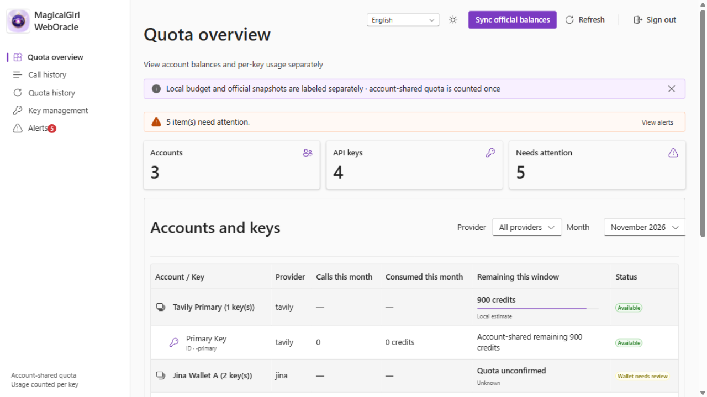
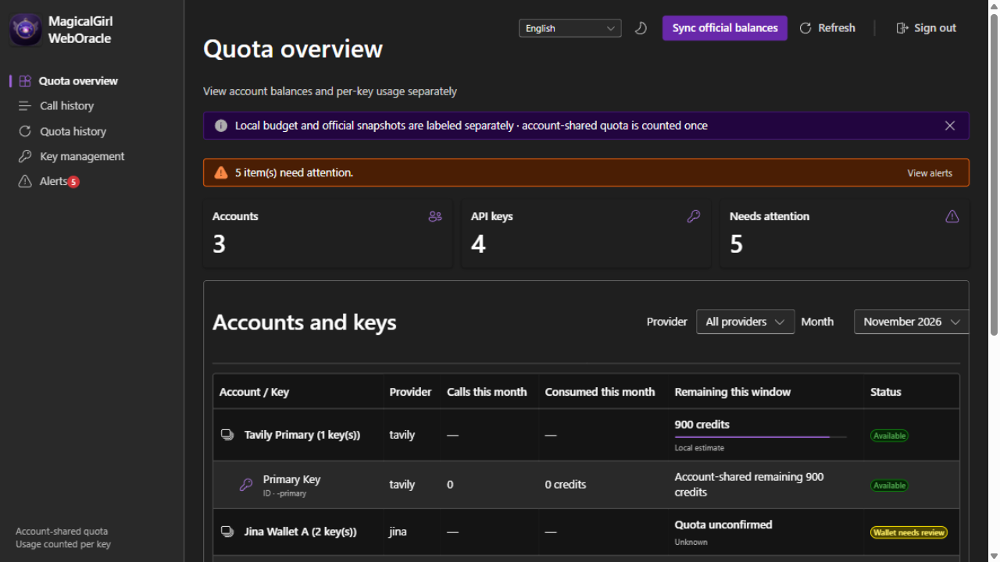

# MagicalGirlWebOracle 🎀


[](https://github.com/LingMoe404/MagicalGirlWebOracle/actions/workflows/ci.yml)
[](https://pypi.org/project/magicalgirl-web-oracle/)
[](https://hub.docker.com/r/lingmoe404/magicalgirl-web-oracle)
[](LICENSE)
[](https://www.python.org/)

[English](README.md) · [简体中文](README.zh-CN.md) · **日本語**

MagicalGirlWebOracle は、AI エージェント向けの**セルフホスト型 Web 検索・調査・ページ取得ルーター**です。Web 検索、ディープリサーチ、ページ取得を 1 つの [MCP](https://modelcontextprotocol.io/) エンドポイントに統合します。プロバイダー、アカウント、キーの選択はすべて自動で、エージェントは質問するだけです。

絶対ルールは 1 つだけです。**無料枠だけを使い、請求を一切発生させない。** `ALLOW_PAID_OVERAGE=false` が既定値であり、唯一サポートされる値です。

## 特長

- **1 つのエンドポイント、多数のバックエンド** — You.com MCP、SearXNG、Exa、Tavily、Jina Reader、Crawl4AI、Firecrawl を MCP / CLI で統一。
- **無料枠を考慮したルーティング** — 品質、コスト、残クォータ、ヘルス、レイテンシを採点し、高価な無料クレジットは難しい質問に温存。
- **セルフホストのフォールバック** — SearXNG + Crawl4AI により、クラウドの無料枠が尽きても検索と取得を継続。
- **中国語インターネット検索** — 中国語クエリは SearXNG の中国語エンジン群（百度、Bing、夸克、搜狗、Bilibili、360 など）へ自動ルーティング。
- **Evidence First** — 調査結果は実在する URL と抜粋を返し、引用を捏造しません。
- **マルチアカウント / マルチキー台帳** — 任意でアカウント別クォータプール、暗号化認証情報、公式残高スナップショット、キーローテーション。
- **Fluent UI 管理ダッシュボード** — ライト / ダークテーマ、英語 / 簡体字中国語 / 繁体字中国語 / 日本語、クォータと呼び出しの確認。
- **監査可能でプライベート** — 既定ではクエリ本文をハッシュ化して保存。テレメトリーなし。設定したプロバイダー以外への通信なし。

## 仕組み

```text
Agent（Claude Code / Codex / 任意の MCP クライアント）
   │  MCP（stdio または streamable HTTP）/ CLI
   ▼
Oracle
   ├── SearchRouter ── 候補採点 → 並列呼び出し → 重複排除・統合 → リランク
   │      プロバイダー：you_mcp / searxng / exa / tavily
   ├── FetchRouter  ── light_http → jina_reader → crawl4ai → firecrawl
   ├── クォータ台帳  ── SQLite：予約、精算、期間、キー別使用量
   ├── ヘルス追跡    ── healthy → degraded → unavailable → クールダウン復帰
   └── 重複排除      ── URL 正規化 + プロバイダー間の一致
```

## ダッシュボード

| ライト | ダーク |
|---|---|
|  |  |

## クイックスタート

### Docker Compose（推奨）

```bash
git clone https://github.com/LingMoe404/MagicalGirlWebOracle.git
cd MagicalGirlWebOracle
cp .env.example .env
```

`.env` を編集します。

- 他のマシンから接続する場合は `MCP_AUTH_TOKEN` に十分長いランダム値を設定。
- 所有しているプロバイダーキー（`EXA_API_KEY`、`TAVILY_API_KEY`、`FIRECRAWL_API_KEY`、`JINA_API_KEY`、`YDC_API_KEY`）を設定。すべて任意です。
- SearXNG / Crawl4AI を動かしている場合は `SEARXNG_URL` / `CRAWL4AI_URL` を設定。
- `MCP_BIND_IP` の既定値は `127.0.0.1`。サービスを意図的に公開する場合のみ `0.0.0.0` や VPN / LAN アドレスに変更。

```bash
docker compose up -d --build
curl -fsS http://127.0.0.1:28288/healthz
```

MCP エンドポイント：`http://127.0.0.1:28288/mcp`。

ワンコマンドスクリプトはイメージ構築、SearXNG / Crawl4AI の自動検出、初回トークン生成、起動、診断をまとめて実行します。

```bash
bash deploy.sh
```

### Docker Hub イメージ

```bash
ORACLE_IMAGE=lingmoe404/magicalgirl-web-oracle:0.1.0 \
  docker compose up -d --no-build
```

### PyPI（ローカル stdio）

```bash
pip install magicalgirl-web-oracle
# 作業ディレクトリに .env を作成するか、環境変数を直接エクスポート
python -m magicalgirl_web_oracle.mcp_server.server
```

## MCP クライアント接続

ローカル stdio：

```json
{
  "mcpServers": {
    "magicalgirl-web-oracle": {
      "command": "python",
      "args": ["-m", "magicalgirl_web_oracle.mcp_server.server"]
    }
  }
}
```

共有 HTTP：

```json
{
  "mcpServers": {
    "magicalgirl-web-oracle": {
      "type": "streamable-http",
      "url": "http://<host>:28288/mcp",
      "headers": { "Authorization": "Bearer <MCP_AUTH_TOKEN>" }
    }
  }
}
```

`MCP_AUTH_TOKEN` が空の場合は `headers` を省略します。コピー用のサンプルは [`examples/mcp/`](examples/mcp/) にあります。

## CLI

```bash
magicalgirl-web search "rust async runtime benchmark" --mode high
magicalgirl-web search "小米 SU7 评测"                 # 中国語エンジンルーティング
magicalgirl-web research "量子計算の主要路線の比較"      # Evidence Pack
magicalgirl-web fetch "https://some-js-heavy-site.com"
magicalgirl-web crawl "https://docs.example.com" --max-pages 20
magicalgirl-web status                                 # ヘルス / クォータ表
magicalgirl-web doctor                                 # 接続診断
```

## MCP ツール

| ツール | 用途 |
|---|---|
| `web_search(query, mode, max_results, provider_override, bypass_cache)` | 自動ルーティング検索。モード：`fast`、`auto`、`high`、`max`。 |
| `web_research(query, max_results, fetch_top, bypass_cache)` | マルチホップ調査。ソース、抜粋、実在する引用を返します。 |
| `fetch_url(url, force_provider, bypass_cache)` | エスカレーションラダーで 1 ページ取得。 |
| `crawl_site(url, max_pages, max_depth)` | 深さ制限付きクロール。セルフホスト Crawl4AI を優先。 |
| `search_status()` | プロバイダーのヘルス、クォータ、スケジューリング、キャッシュ状態。 |
| `search_debug(query, provider, max_results)` | 1 プロバイダーを強制して比較。 |

## 設定

設定は `.env`、`config/providers.yaml`、`config/router_policy.yaml` にあります。プロバイダーキーはすべて任意で、欠けているキーはそのプロバイダーをルーティングから外すだけです。

環境変数、既定値、キャッシュ / スケジューリング、YAML の詳細は **[docs/configuration.md](docs/configuration.md)** を参照してください。

## マルチアカウント管理画面

任意の管理画面では、複数のプロバイダーアカウントとキーを管理できます。認証情報は Fernet マスターキーで暗号化され、公式残高スナップショット、アラート、呼び出しトレース、キャッシュ、スケジューリング判断を表示します。

```bash
# .env：ORACLE_ADMIN_TOKEN、ORACLE_VAULT_KEY、ORACLE_ACCOUNTS_FILE
docker compose --profile admin up -d
```

`https://127.0.0.1:28443/admin/` を開き、`ORACLE_ADMIN_TOKEN` でログインします。アカウントモデル、キー管理、バックアップ、セキュリティは **[docs/multi-key-setup.md](docs/multi-key-setup.md)** を参照してください。

## セキュリティとプライバシー

- HTTP サーバーは既定で `127.0.0.1` にバインドします。信頼できるネットワークまたは VPN のみに公開し、`MCP_AUTH_TOKEN` を設定してください。
- 管理トークンは MCP トークンとは独立しています。空の場合は管理画面が無効になります。
- プロバイダーキーは `.env`、環境変数、またはローカル台帳内の Fernet 暗号文にのみ存在します。API 応答やログに完全な認証情報を返しません。
- クエリ本文は既定では保存せず、ソルト付きハッシュのみを保存します（`STORE_QUERY_TEXT=false`）。
- `402` / 支払い要求の応答はクォータ枯渇として扱います。有料超過を有効にするコードパスはありません。
- テレメトリーはなく、設定したプロバイダーとセルフホストサービス以外への通信は行いません。

1 台のマシン以外に公開する前に **[SECURITY.md](SECURITY.md)** を読んでください。

## デプロイと運用

Docker Compose、任意の HTTPS 管理リスナー、SearXNG / Crawl4AI、VPN / リバースプロキシ、バックアップ、アップグレード、トラブルシューティングは **[docs/deployment.md](docs/deployment.md)** を参照してください。

## 制限と留意事項

- 現在は `0.1.x` のベータ版です。`1.0` までにインターフェースが変わる可能性があります。
- 無料枠やプロバイダー API は予告なく変更されることがあります。各プロバイダーの利用規約に従ってください。本プロジェクトは無料であることを保証しません。
- コンテナは現在 root で動作します。内蔵の管理リスナーは既定で自己署名証明書を使用します。
- プロジェクト名の「Oracle」は説明的な語です。Oracle 社および検索プロバイダーとは提携・推奨関係にありません。

## 開発

```bash
python -m venv .venv
# Windows: .venv\Scripts\activate
source .venv/bin/activate
pip install -e ".[dev]"
python -m pytest

cd frontend
npm ci
npm run build   # src/.../admin/static/ に管理バンドルを生成
```

既定のテストスイートはすべてモックで、キーもネットワークも不要です。

## ライセンス

MIT — [LICENSE](LICENSE) を参照してください。[`assets/icon/`](assets/icon/) のアイコンは LingMoe404 のオリジナル作品で、同じライセンスで提供されます。第三者通知は [THIRD_PARTY_NOTICES.md](THIRD_PARTY_NOTICES.md) にあります。
