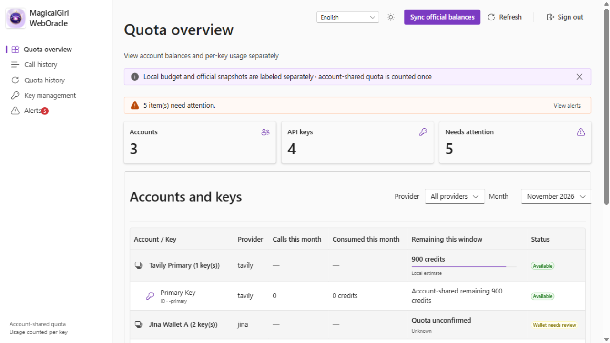
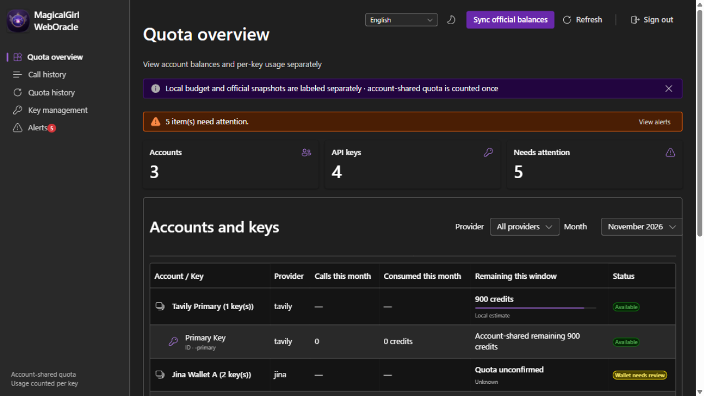

# MagicalGirlWebOracle 🎀


[](https://github.com/LingMoe404/MagicalGirlWebOracle/actions/workflows/ci.yml)
[](https://pypi.org/project/magicalgirl-web-oracle/)
[](https://hub.docker.com/r/lingmoe404/magicalgirl-web-oracle)
[](LICENSE)
[](https://www.python.org/)

**English** · [简体中文](README.zh-CN.md) · [日本語](README.ja.md)

MagicalGirlWebOracle is a self-hosted **web search, deep research, and page
fetching router for AI agents**, exposed through a single
[Model Context Protocol](https://modelcontextprotocol.io/) endpoint. It selects
providers, accounts, and keys automatically — the agent just asks.

The hard rule is simple: **use free quotas only, and never create a bill.**
`ALLOW_PAID_OVERAGE=false` is the default and the only supported value.

## Highlights

- **One endpoint, many backends** — You.com MCP, SearXNG, Exa, Tavily, Jina
  Reader, Crawl4AI, and Firecrawl behind one MCP/CLI interface.
- **Free-tier aware routing** — scores quality, cost, remaining quota, health,
  and latency; expensive free credits are reserved for harder questions.
- **Self-hosted fallback** — SearXNG + Crawl4AI keep search and fetching
  working even when every cloud quota is exhausted.
- **Chinese internet search** — Chinese queries are routed to a SearXNG engine
  matrix (Baidu, Bing, Quark, Sogou, Bilibili, 360, …).
- **Evidence first** — research responses contain real source URLs and
  excerpts, never fabricated citations.
- **Multi-account / multi-key ledger** — optional per-account quota pools,
  encrypted credentials, official balance snapshots, and key rotation.
- **Fluent UI admin dashboard** — light/dark themes, English / Simplified
  Chinese / Traditional Chinese / Japanese, quota and call inspection.
- **Auditable but private** — query text is hashed by default; no telemetry and
  no outbound calls except the providers you configure.

## How it works

```text
Agent (Claude Code / Codex / any MCP client)
   │  MCP (stdio or streamable HTTP) / CLI
   ▼
Oracle
   ├── SearchRouter ── score candidates → concurrent calls → dedup/merge → rerank
   │      providers: you_mcp / searxng / exa / tavily
   ├── FetchRouter  ── light_http → jina_reader → crawl4ai → firecrawl
   ├── Quota ledger ── SQLite: reservations, settlement, windows, per-key usage
   ├── HealthTracker ─ healthy → degraded → unavailable → cooldown recovery
   └── Dedup         ─ URL canonicalization + cross-provider agreement
```

## Dashboard

| Light | Dark |
|---|---|
|  |  |

## Quick start

### Docker Compose (recommended)

```bash
git clone https://github.com/LingMoe404/MagicalGirlWebOracle.git
cd MagicalGirlWebOracle
cp .env.example .env
```

Edit `.env`:

- Set `MCP_AUTH_TOKEN` to a long random value if other machines will connect.
- Add the provider keys you have (`EXA_API_KEY`, `TAVILY_API_KEY`,
  `FIRECRAWL_API_KEY`, `JINA_API_KEY`, `YDC_API_KEY`); every key is optional.
- Set `SEARXNG_URL` / `CRAWL4AI_URL` if you run those services.
- `MCP_BIND_IP` defaults to `127.0.0.1`. Set it to `0.0.0.0` (or a VPN/LAN
  address) only when you intentionally expose the service.

```bash
docker compose up -d --build
curl -fsS http://127.0.0.1:28288/healthz
```

MCP endpoint: `http://127.0.0.1:28288/mcp`.

The one-command script builds the image, auto-detects SearXNG/Crawl4AI,
generates a token on first run, starts the service, and runs diagnostics:

```bash
bash deploy.sh
```

### Docker Hub image

```bash
ORACLE_IMAGE=lingmoe404/magicalgirl-web-oracle:0.1.0 \
  docker compose up -d --no-build
```

### PyPI (local stdio)

```bash
pip install magicalgirl-web-oracle
# create .env in the working directory, or export the variables directly
python -m magicalgirl_web_oracle.mcp_server.server
```

## Connect an MCP client

Local stdio:

```json
{
  "mcpServers": {
    "magicalgirl-web-oracle": {
      "command": "python",
      "args": ["-m", "magicalgirl_web_oracle.mcp_server.server"]
    }
  }
}
```

Shared HTTP:

```json
{
  "mcpServers": {
    "magicalgirl-web-oracle": {
      "type": "streamable-http",
      "url": "http://<host>:28288/mcp",
      "headers": { "Authorization": "Bearer <MCP_AUTH_TOKEN>" }
    }
  }
}
```

Omit `headers` when `MCP_AUTH_TOKEN` is empty. See
[`examples/mcp/`](examples/mcp/) for copy-paste files.

## CLI

```bash
magicalgirl-web search "rust async runtime benchmark" --mode high
magicalgirl-web search "小米 SU7 评测"                 # Chinese engine routing
magicalgirl-web research "量子计算主流路线对比"          # evidence pack
magicalgirl-web fetch "https://some-js-heavy-site.com"
magicalgirl-web crawl "https://docs.example.com" --max-pages 20
magicalgirl-web status                                 # health/quota table
magicalgirl-web doctor                                 # connectivity diagnostics
```

## MCP tools

| Tool | Purpose |
|---|---|
| `web_search(query, mode, max_results, provider_override, bypass_cache)` | Search with automatic routing. Modes: `fast`, `auto`, `high`, `max`. |
| `web_research(query, max_results, fetch_top, bypass_cache)` | Multi-hop research; returns sources, excerpts, and real citations. |
| `fetch_url(url, force_provider, bypass_cache)` | Fetch one page through the escalation ladder. |
| `crawl_site(url, max_pages, max_depth)` | Depth-limited crawl; prefers self-hosted Crawl4AI. |
| `search_status()` | Provider health, quota, scheduling, and cache status. |
| `search_debug(query, provider, max_results)` | Force one provider for comparison. |

## Configuration

Configuration lives in `.env` plus `config/providers.yaml` and
`config/router_policy.yaml`. All provider keys are optional; a missing key just
removes that provider from routing.

See **[docs/configuration.md](docs/configuration.md)** for every environment
variable, defaults, cache/scheduling options, and the YAML files.

## Multi-account dashboard

The optional dashboard manages multiple provider accounts and keys, encrypted
with a Fernet master key, and shows official balance snapshots, alerts, call
traces, cache counters, and scheduling decisions.

```bash
# .env: ORACLE_ADMIN_TOKEN, ORACLE_VAULT_KEY, ORACLE_ACCOUNTS_FILE
docker compose --profile admin up -d
```

Open `https://127.0.0.1:28443/admin/` and sign in with `ORACLE_ADMIN_TOKEN`.
See **[docs/multi-key-setup.md](docs/multi-key-setup.md)** for the account
model, key management, backups, and security notes.

## Security and privacy

- The HTTP server binds to `127.0.0.1` by default; expose it only on a trusted
  network or VPN and set `MCP_AUTH_TOKEN`.
- The admin token is independent from the MCP token; empty disables the UI.
- Provider keys live in `.env`, environment variables, or Fernet ciphertext in
  the local ledger. They are never returned by APIs or written to logs.
- Query text is not stored unless `STORE_QUERY_TEXT=true`; the default is a
  salted hash.
- `402` / payment-required responses are classified as quota exhaustion. There
  is no code path that enables paid overage.
- The service has no telemetry and makes no network requests except to the
  providers and self-hosted services you configure.

Read **[SECURITY.md](SECURITY.md)** before exposing the service beyond a single
machine.

## Deployment and operations

See **[docs/deployment.md](docs/deployment.md)** for Docker Compose, the
optional HTTPS admin listener, SearXNG/Crawl4AI setup, VPN/reverse-proxy
guidance, backups, upgrades, and troubleshooting.

## Limitations and responsible use

- This is a `0.1.x` beta; interfaces may change before `1.0`.
- Free-tier quotas and provider APIs can change without notice. Use the
  service in accordance with each provider's terms. The project cannot
  guarantee that any provider remains free.
- The container currently runs as root; the bundled admin listener uses a
  self-signed certificate by default.
- “Oracle” in the project name is descriptive. This project is not affiliated
  with Oracle Corporation or with any search provider.

## Development

```bash
python -m venv .venv
# Windows: .venv\Scripts\activate
source .venv/bin/activate
pip install -e ".[dev]"
python -m pytest

cd frontend
npm ci
npm run build   # writes the admin bundle into src/.../admin/static/
```

The default test suite is fully mocked and needs no keys or network access.

## License

MIT — see [LICENSE](LICENSE). The icon artwork in
[`assets/icon/`](assets/icon/) is original work by LingMoe404 and is distributed
under the same license. Third-party notices are in
[THIRD_PARTY_NOTICES.md](THIRD_PARTY_NOTICES.md).
