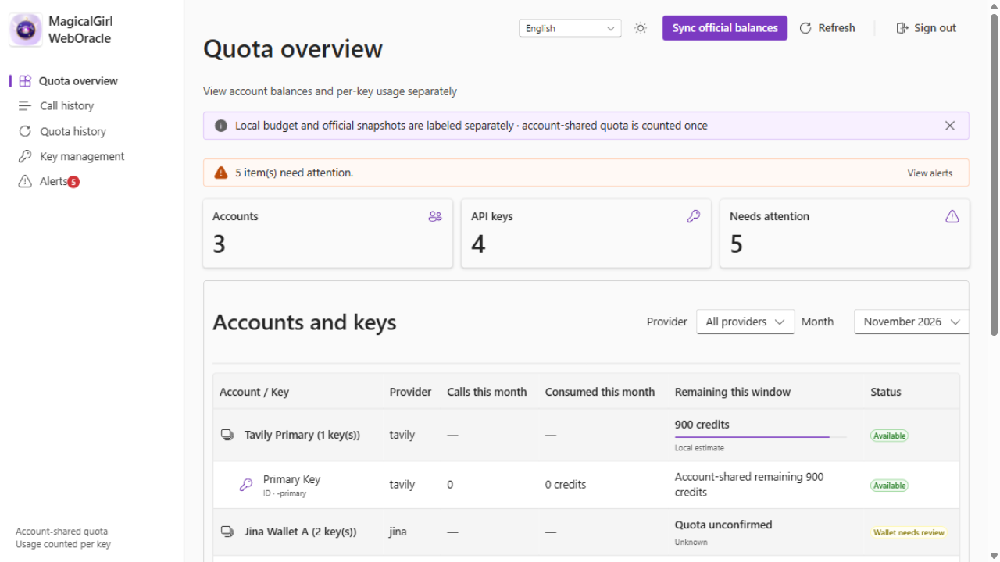
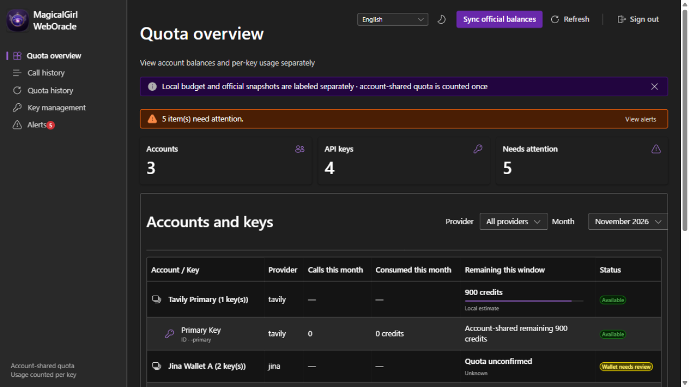

# MagicalGirlWebOracle 🎀


[](https://github.com/LingMoe404/MagicalGirlWebOracle/actions/workflows/ci.yml)
[](https://pypi.org/project/magicalgirl-web-oracle/)
[](https://hub.docker.com/r/lingmoe404/magicalgirl-web-oracle)
[](LICENSE)
[](https://www.python.org/)

[English](README.md) · **简体中文** · [日本語](README.ja.md)

MagicalGirlWebOracle 是一个自托管的 **AI Agent 联网路由服务**：把网页搜索、深度调研和页面抓取统一到一个 [MCP](https://modelcontextprotocol.io/) 端点。供应商、账户和 Key 的选择全部自动完成，Agent 只需要提问。

硬规则只有一条：**只用免费额度，绝不产生账单。** `ALLOW_PAID_OVERAGE=false` 是默认值，也是唯一支持的值。

## 特性

- **一个端点，多种后端** —— You.com MCP、SearXNG、Exa、Tavily、Jina Reader、Crawl4AI、Firecrawl 统一到 MCP / CLI。
- **免费额度感知的路由** —— 综合质量、成本、剩余额度、健康度和延迟评分，把昂贵的免费额度留给更难的问题。
- **自建兜底** —— SearXNG + Crawl4AI 让搜索和抓取在云端额度耗尽时仍然可用。
- **中文互联网增强** —— 中文问题自动路由到 SearXNG 中文引擎矩阵（百度、必应、夸克、搜狗、B 站、360 等）。
- **Evidence First** —— 调研结果返回真实来源 URL 和摘录，不编造引用。
- **多账户 / 多 Key 账本** —— 可选的独立额度池、加密凭据、官方余额快照和 Key 轮换。
- **Fluent UI 管理台** —— 明暗主题，英文 / 简体中文 / 繁体中文 / 日文，额度与调用追踪。
- **可审计且注重隐私** —— 默认只保存 query 哈希；无遥测，除你配置的供应商外不发起外部请求。

## 工作原理

```text
Agent（Claude Code / Codex / 任意 MCP 客户端）
   │  MCP（stdio 或 streamable HTTP）/ CLI
   ▼
Oracle
   ├── SearchRouter ── 候选评分 → 并发调用 → 去重合并 → 重排
   │      供应商：you_mcp / searxng / exa / tavily
   ├── FetchRouter  ── light_http → jina_reader → crawl4ai → firecrawl
   ├── 额度账本      ── SQLite：预留、结算、账期、逐 Key 用量
   ├── 健康追踪      ── healthy → degraded → unavailable → 冷却恢复
   └── 去重          ── URL 规范化 + 多源交叉命中
```

## 管理台

| 浅色 | 深色 |
|---|---|
|  |  |

## 快速开始

### Docker Compose（推荐）

```bash
git clone https://github.com/LingMoe404/MagicalGirlWebOracle.git
cd MagicalGirlWebOracle
cp .env.example .env
```

编辑 `.env`：

- 如果其他机器会连接，把 `MCP_AUTH_TOKEN` 设为足够长的随机值。
- 填入你拥有的供应商 Key（`EXA_API_KEY`、`TAVILY_API_KEY`、`FIRECRAWL_API_KEY`、`JINA_API_KEY`、`YDC_API_KEY`）；所有 Key 都是可选的。
- 如果运行了 SearXNG / Crawl4AI，设置 `SEARXNG_URL` / `CRAWL4AI_URL`。
- `MCP_BIND_IP` 默认是 `127.0.0.1`。只有在明确要暴露服务时，才改成 `0.0.0.0` 或某个 VPN / 局域网地址。

```bash
docker compose up -d --build
curl -fsS http://127.0.0.1:28288/healthz
```

MCP 端点：`http://127.0.0.1:28288/mcp`。

一键脚本会构建镜像、自动探测 SearXNG / Crawl4AI、首次运行时生成令牌、启动服务并做诊断：

```bash
bash deploy.sh
```

### Docker Hub 镜像

```bash
ORACLE_IMAGE=lingmoe404/magicalgirl-web-oracle:0.1.0 \
  docker compose up -d --no-build
```

### PyPI（本机 stdio）

```bash
pip install magicalgirl-web-oracle
# 在工作目录创建 .env，或直接导出环境变量
python -m magicalgirl_web_oracle.mcp_server.server
```

## 连接 MCP 客户端

本机 stdio：

```json
{
  "mcpServers": {
    "magicalgirl-web-oracle": {
      "command": "python",
      "args": ["-m", "magicalgirl_web_oracle.mcp_server.server"]
    }
  }
}
```

共享 HTTP：

```json
{
  "mcpServers": {
    "magicalgirl-web-oracle": {
      "type": "streamable-http",
      "url": "http://<host>:28288/mcp",
      "headers": { "Authorization": "Bearer <MCP_AUTH_TOKEN>" }
    }
  }
}
```

`MCP_AUTH_TOKEN` 为空时省略 `headers`。可直接复制 [`examples/mcp/`](examples/mcp/) 下的示例。

## CLI

```bash
magicalgirl-web search "rust async runtime benchmark" --mode high
magicalgirl-web search "小米 SU7 评测"                 # 中文引擎路由
magicalgirl-web research "量子计算主流路线对比"          # Evidence Pack
magicalgirl-web fetch "https://some-js-heavy-site.com"
magicalgirl-web crawl "https://docs.example.com" --max-pages 20
magicalgirl-web status                                 # 健康度 / 额度表
magicalgirl-web doctor                                 # 连通性诊断
```

## MCP 工具

| 工具 | 用途 |
|---|---|
| `web_search(query, mode, max_results, provider_override, bypass_cache)` | 自动路由搜索；模式：`fast`、`auto`、`high`、`max`。 |
| `web_research(query, max_results, fetch_top, bypass_cache)` | 多跳调研；返回来源、摘录和真实引用。 |
| `fetch_url(url, force_provider, bypass_cache)` | 按升级链抓取单个页面。 |
| `crawl_site(url, max_pages, max_depth)` | 有深度限制的站点抓取，优先自建 Crawl4AI。 |
| `search_status()` | 供应商健康度、额度、调度和缓存状态。 |
| `search_debug(query, provider, max_results)` | 强制指定单个供应商做对比。 |

## 配置

配置来自 `.env`、`config/providers.yaml` 和 `config/router_policy.yaml`。所有供应商 Key 都是可选的；缺少某个 Key 只会让对应供应商退出路由。

完整环境变量、默认值、缓存 / 调度选项和 YAML 说明见 **[docs/configuration.zh-CN.md](docs/configuration.zh-CN.md)**。

## 多账户管理台

可选管理台支持多个供应商账户和 Key，凭据使用 Fernet 主密钥加密，并展示官方余额快照、提醒、调用追踪、缓存计数和调度决策。

```bash
# .env：ORACLE_ADMIN_TOKEN、ORACLE_VAULT_KEY、ORACLE_ACCOUNTS_FILE
docker compose --profile admin up -d
```

打开 `https://127.0.0.1:28443/admin/`，用 `ORACLE_ADMIN_TOKEN` 登录。账户模型、Key 管理、备份和安全说明见 **[docs/multi-key-setup.zh-CN.md](docs/multi-key-setup.zh-CN.md)**。

## 安全与隐私

- HTTP 服务默认只绑定 `127.0.0.1`；只有可信网络或 VPN 才对外开放，并设置 `MCP_AUTH_TOKEN`。
- 管理令牌独立于 MCP 令牌；为空时管理台关闭。
- 供应商 Key 只存在于 `.env`、环境变量或本地账本的 Fernet 密文中，API 响应和日志不会返回完整凭据。
- 默认不保存 query 原文，只保存加盐哈希（`STORE_QUERY_TEXT=false`）。
- `402` / 需要付款的响统一归类为额度耗尽；没有任何代码路径会开启付费超支。
- 服务没有遥测，除你配置的供应商和自建服务外不发起网络请求。

把服务暴露到单机之外前，请先阅读 **[SECURITY.zh-CN.md](SECURITY.zh-CN.md)**。

## 部署与运维

Docker Compose、独立 HTTPS 管理监听、SearXNG / Crawl4AI 配置、VPN / 反向代理、备份、升级和排障见 **[docs/deployment.zh-CN.md](docs/deployment.zh-CN.md)**。

## 限制与合规

- 当前是 `0.1.x` beta，`1.0` 前接口可能变化。
- 免费额度和供应商 API 可能随时调整；请遵守各供应商的服务条款。本项目无法保证任何供应商永久免费。
- 容器当前以 root 运行；内置管理监听默认使用自签名证书。
- 项目名中的 “Oracle” 仅作描述用途，本项目与 Oracle 公司及任何搜索供应商无隶属或背书关系。

## 开发

```bash
python -m venv .venv
# Windows: .venv\Scripts\activate
source .venv/bin/activate
pip install -e ".[dev]"
python -m pytest

cd frontend
npm ci
npm run build   # 生成 src/.../admin/static/ 下的管理台资源
```

默认测试全部使用 mock，不需要任何 Key，也不需要联网。

## 许可证

MIT，见 [LICENSE](LICENSE)。[`assets/icon/`](assets/icon/) 中的图标为 LingMoe404 原创作品，采用同一许可证。第三方声明见 [THIRD_PARTY_NOTICES.md](THIRD_PARTY_NOTICES.md)。
